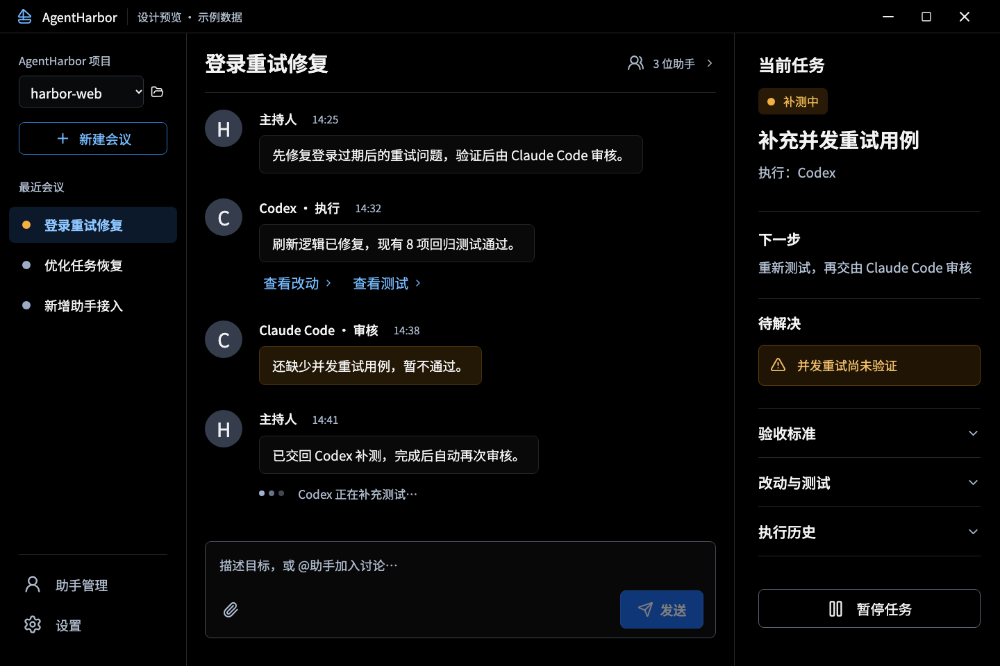

# AgentHarbor

让本机的 AI 编程助手围绕一个目标协作，并用真实测试和独立审核判断任务是否完成。

**桌面首版：0.2.0-alpha.3。** 采用 Electron + React，共用 Windows、Linux、macOS 代码。界面以助手会议为中心：左侧选择项目和会议，中间查看执行与审核对话，右侧查看任务、改动和测试证据。

[English](README.en.md) · [下载与发布](https://github.com/otterview-labs/agentharbor/releases) · [桌面使用说明](docs/desktop-alpha.md) · [测试记录](docs/verification.md) · [架构](docs/architecture.md) · [路线图](docs/ROADMAP.md)



上图来自实际运行的浏览器设计预览，会议和任务是明确标记的示例数据。原生桌面首次启动为空，可添加自己的本地项目；示例记录不会混入真实任务。

## 为什么做这个项目

希望让已安装的多个编程助手接力解决问题：一个执行，另一个审核，测试失败或审核提出问题时继续修改，直到满足明确的验收条件或达到预算。用户能看到发生了什么、为什么停下，以及完成的证据。

AgentHarbor 是独立桌面仓库；手机端 [agentBridge](https://github.com/otterview-labs/agentBridge) 单独维护。本机使用不需要自建云端服务器；模型请求仍使用各助手已有的服务和登录配置。电脑需要保持运行。

## 首版可以做什么

- 检测本机 Codex、Claude Code、OpenCode、Looper、Git 和 GitHub CLI。工具存在、版本可读、账号已认证是不同状态。
- 添加普通文件夹或本地 Git 项目，创建带目标、验收标准和检查命令的任务。
- 普通文件夹在任务副本中执行，Git 项目在独立 worktree 中执行，由 Codex、Claude Code 分别担任执行与审核角色。
- 自动推进“实现 → 运行检查 → 独立审核 → 按问题返工”，限制最大轮数；不会仅凭模型说“完成”结束任务。
- 在会议里保留助手输出、用户补充和文本附件；查看代码差异、测试结果、审核结论与执行历史。
- 暂停、继续任务，关闭应用后保留会议和任务记录。

当前会议由固定流程主持，尚不支持任意多个助手自由讨论、`@助手` 路由或自动拆解大型项目。用户补充在下一次模型调用时读取；不会打断当前请求。OpenCode 当前仅能发现，Jev 尚未接入。该版本尚不是无需干预、永久运行的项目主管。

## 开始使用

下载对应平台的 ZIP，解压运行。首版尚未签名或公证，应用图标暂沿用 Electron 默认图标。使用前需要配置好 Codex 和 Claude Code CLI。普通文件夹无需 Git；Git 项目才需要安装 Git。**Windows 的 npm `.cmd` 启动器适配仍待实现：Windows 桌面构建和夹具流程通过，不代表真实 Windows 助手已跑通。**

从源码启动需要 Node.js 22.13+：

```bash
npm ci
npm run desktop
```

1. 点击“添加本地项目”，选择可信的普通文件夹或 Git 仓库。
2. Git 项目需先提交或收起当前改动；普通文件夹无需初始化仓库。新建任务，填写目标、验收标准和真实检查命令。
3. 选择不同的执行与审核工具，启动任务。需要依赖的项目应先在任务工作区准备依赖；worktree 不复制原目录的 `node_modules`。
4. 查看右侧的“改动与测试”，确认代码和证据。改动保留在任务 worktree，首版不会自动提交、推送或合并。

状态保存在 `~/.agentharbor`，可通过 `AGENTHARBOR_HOME` 切换；日志和附件可能包含项目内容，请保存在本机。worktree 提供改动隔离；模型工具和验证命令以当前用户身份运行。详细限制见[桌面说明](docs/desktop-alpha.md)。

```bash
npm run build:desktop
npm run preview:desktop   # 浏览器示例预览，不执行本地任务
npm run package:desktop   # 当前平台 ZIP
```

## 已验证的范围

- 严格 TypeScript 检查通过，23 项运行时测试通过。
- 3 项原生 Electron 测试覆盖普通文件夹与 Git 项目的创建、执行、真实检查、审核、持久化恢复，以及暂停继续；模型使用确定性夹具。
- macOS 上已通过真实 Codex → 主机测试 → 真实 Claude Code 的桌面闭环，源目录保持不变，审核绑定测试时的源文件指纹。
- Windows、Linux、macOS 的原生夹具测试与 ZIP 构建通过 CI；这与三平台真实模型认证验证分开记录。

可复现命令、CI 链接和已知限制见[测试记录](docs/verification.md)。

## CLI 与上游

原有 CLI 仍可使用：

```bash
npm run build
node dist/src/cli.js doctor
node dist/src/cli.js create --file /absolute/path/mission.json
node dist/src/cli.js run --id <mission-id>
node dist/src/cli.js show --id <mission-id>
```

输入格式见 [examples/mission.json](examples/mission.json)。退出码 0 表示完成，2 表示任务仍未完成，1 表示命令失败。硬崩溃留下的锁需要确认进程已退出后，按提示处理。

[Looper](https://github.com/nexu-io/looper) 是 MIT 开源的架构参考与可选外部引擎；本仓库是独立实现，通过适配器调用其 CLI。首版没有宣称跑通 Looper 的完整 Issue → PR → 自动合并闭环。见[集成范围](docs/looper.md)与[第三方声明](THIRD_PARTY_NOTICES.md)。

```bash
npm run check
npm run check:desktop
npm test
npm run build:desktop
npm run test:desktop
```

MIT License.

## 普通文件夹

选择文件夹即可添加，不需要 `git init`，也不会自动创建 `.git`。创建任务时复制工作文件到独立任务目录，执行和审核均在副本中进行；原目录保持不变。完成后点击“改动与测试 → 打开工作区”查看或取回结果，首版不会自动覆盖原目录。普通文件夹的改动检查显示相对初始快照的新增、修改、删除列表；Git 模式仍提供 Git diff。

副本和文件指纹排除 `.git`、`node_modules`、Python 虚拟环境/缓存、`dist`、`build`、`coverage`、`.next`、`.nuxt`、`.cache`、`target`、`.gradle` 等依赖与构建目录，暂不解析 `.gitignore` 自定义规则。请在任务副本准备依赖，并为任务指定真实、可信的检查命令。排除的输出不属于源文件指纹。

普通文件夹不设置文件数量、目录条目数、单文件大小或总大小的人为上限。文件内容按流读取和校验，系统支持时复制使用写时复制（reflink），不支持时正常复制。实际可处理规模取决于本机资源。暂不支持符号链接或特殊文件。请选择具体的项目或工作目录；不要选择包含 AgentHarbor 数据目录的上级目录。
