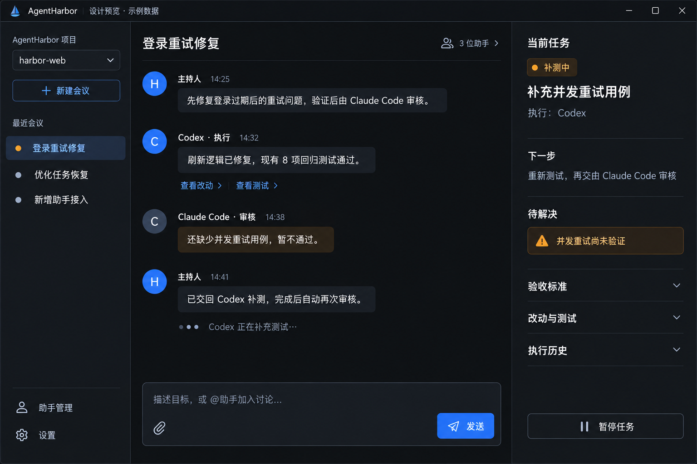
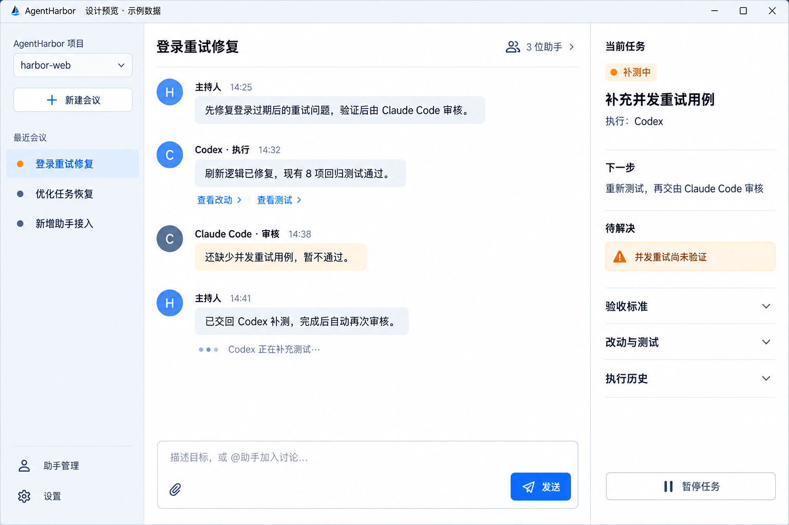
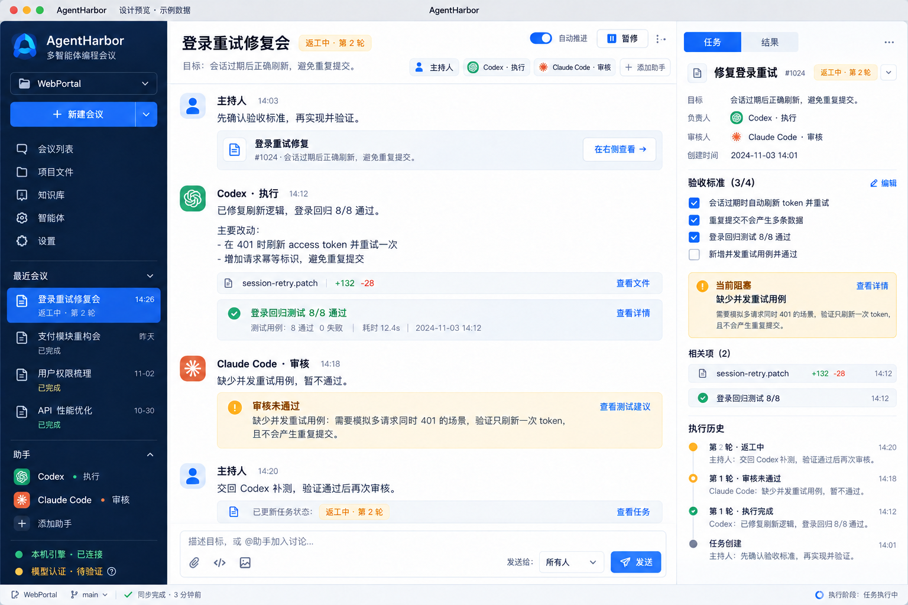
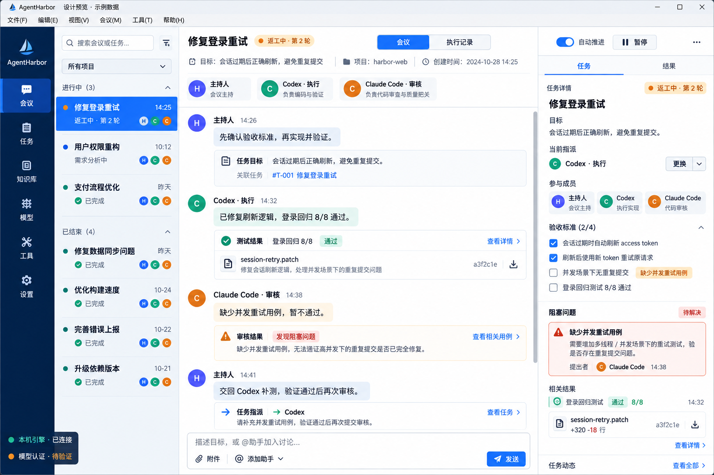
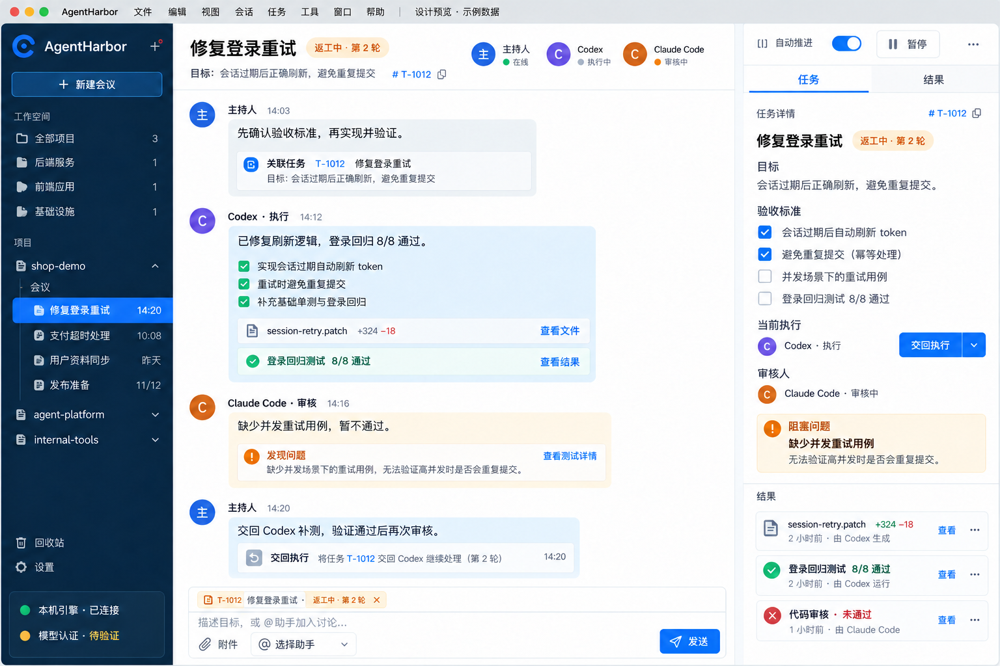

# Desktop meeting workspace — design proposals

These are **generated design mockups with synthetic data**, not screenshots of a working desktop application. The user selected a chat application interaction model: assistants meet in the center; tasks and results stay in the side pane. The user now requests a polished black-background desktop tool. The current dark simplified layout is pending approval; previous alternatives remain comparison material. The earlier dashboard-style proposals were rejected and are not the implementation target.

Window controls illustrate macOS or Windows variants, not separate codebases. The future Electron host will use the correct native chrome for the running OS. Brand mark, example dates and UI copy in generated images are provisional; completion states must derive from runtime evidence in the actual application.

## Current refinement — black-background desktop tool

The user requested a black background while preserving the simplified meeting layout. Near-black conversation surfaces, subtly lighter charcoal side panes and a raised dark composer replace the light theme. Off-white text and restrained blue actions preserve readability; amber marks incomplete work. Secondary details stay collapsed.

[Exact dark-comp edit prompt and approval state](../.impeccable/mocks/desktop-chat-dark.png.json).

Earlier simplified light preview — not approved

## Earlier refinement — simpler meeting workspace

The user found A/B/C cluttered. This refinement keeps three panes but removes the extra activity rail, repeated task cards, member badges, expanded acceptance checklist and duplicated result blocks. The conversation holds short assistant messages and evidence links. The right inspector shows the current task, executor, next step and blocker; acceptance, changes/tests and history stay collapsed.

[Exact generation prompt and approval state](../.impeccable/mocks/desktop-chat-simple.png.json).

Earlier A / B / C proposals — not approved

## A — Project and meeting workspace

Three panes: combined project/meeting sidebar, central assistant discussion, right task inspector with evidence and history. Suits one focused meeting at a time.

## B — Messaging application structure

Activity rail, searchable meeting list, central discussion and a persistent right task/results inspector. Suits several simultaneous projects or meetings.

## C — Project tree and focused conversation

Project tree on the left, broad conversation in the middle, task details and selected results in the right dock. Suits frequent movement between projects and their conversations.

Generated with the built-in image_gen tool. Exact prompts, edit history and `approved: false` metadata accompany the files; the final generation/edit prompt is also embedded in each PNG. No renderer code should be implemented from these proposals until a complete layout is approved.
